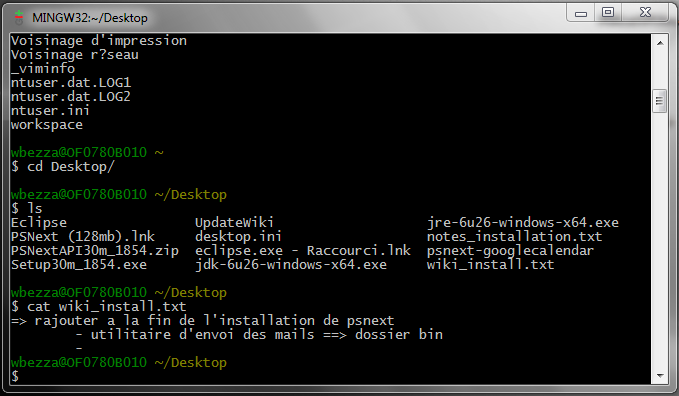
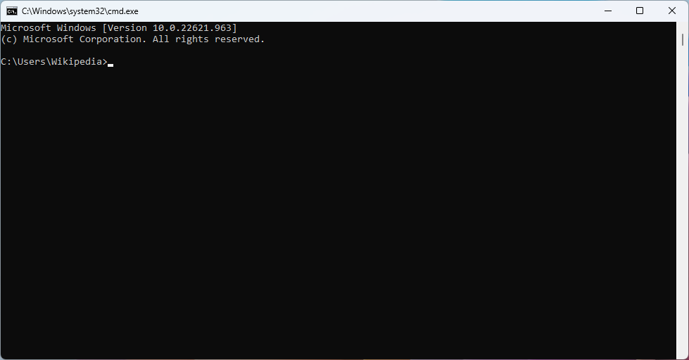
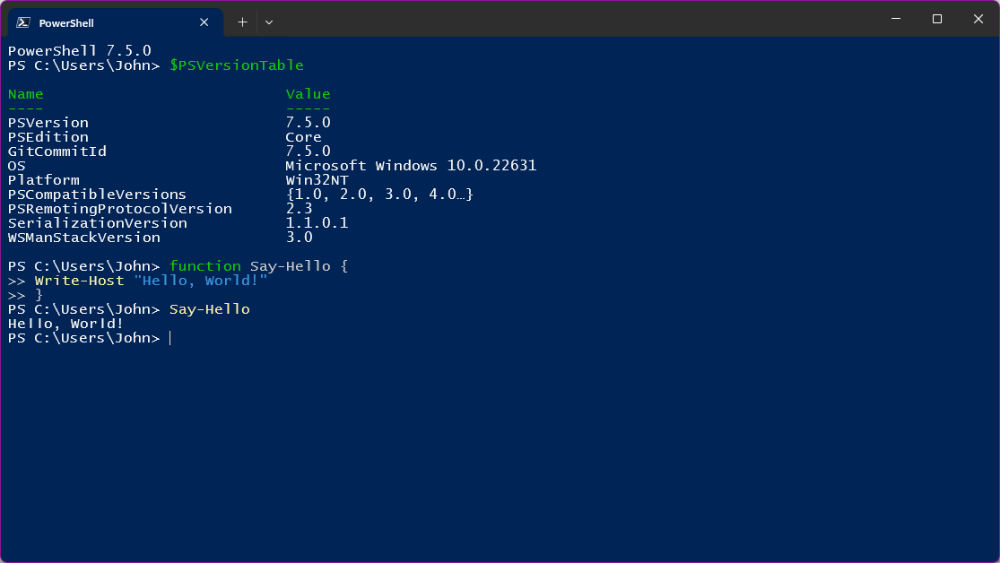
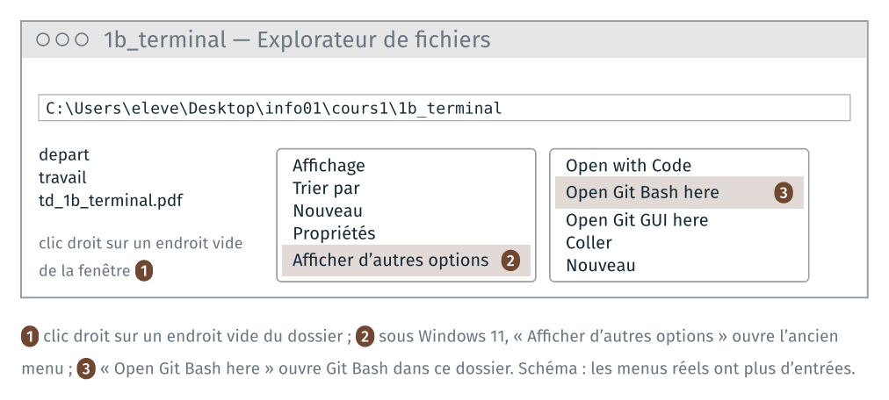
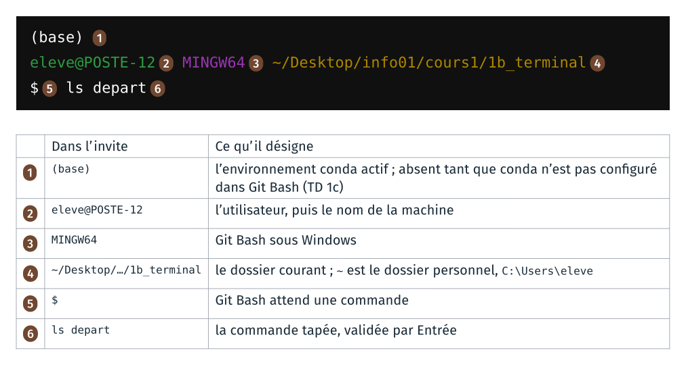
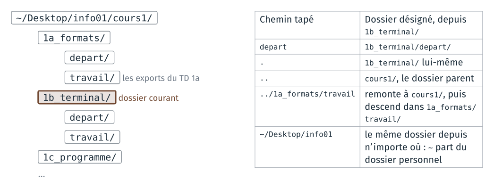

*Version 2 du cours 1 : proposition de travail pour 2027-2028. Ce TD est
nouveau : il reprend en ligne de commande une partie du TD 1a de 2026
(renommer une extension, un espace dans un nom).*

Le TD refait au clavier, dans un terminal, ce que le TD 1a a fait à la
souris : se déplacer dans les dossiers, copier, renommer et ouvrir des
fichiers. Il dure une quinzaine de minutes.

Le terminal du module est **Git Bash**, installé avec git sur les postes de
la salle. Les commandes de ce guide sont celles de bash : elles se tapent à
l'identique dans le terminal de macOS et de Linux.

| Étape | Objectif | Ce qu'on fait |
|---|---|---|
| 1 | situer le terminal dans l'arborescence | ouvrir Git Bash dans le dossier du TD, et lire l'invite |
| 2 | se déplacer par des chemins relatifs | se déplacer et lister le contenu des dossiers |
| 3 | manipuler des fichiers par des commandes | copier, renommer et ouvrir des fichiers |
| 4 | écrire un chemin qui contient un espace | écrire un nom de fichier qui contient un espace |
| 5 | agir sur plusieurs fichiers en une commande | copier plusieurs fichiers d'un coup, supprimer un fichier |

## Rappels avant de commencer

**Un terminal, plusieurs fenêtres.** Le poste a plusieurs terminaux :
l'invite de commandes (`cmd`), PowerShell, Git Bash. Chacun a son langage.
Les commandes du guide sont celles de Git Bash, et la dernière annexe donne
leurs équivalents dans les deux autres. L'invite, au début de chaque ligne,
indique le terminal employé :

| Git Bash | Invite de commandes | PowerShell |
|---|---|---|
|  |  |  |
| `utilisateur@machine MINGW64 ~/…`, puis `$` | `C:\Users\…>` | `PS C:\Users\…>` |

La capture de Git Bash date de 2011 (`MINGW32`). Sources et licences :
`images/terminaux/CREDITS.md` dans le dépôt du cours.

**Taper une commande.** Une commande se tape après le `$`, puis se valide
par `Entrée`. Deux touches font gagner du temps :

| Touche | Ce qu'elle fait |
|---|---|
| flèche vers le haut | rappelle la commande précédente, à modifier ou relancer |
| `Tab` | complète le nom de fichier ou de dossier commencé |
| `Ctrl` + `C` | interrompt la commande en cours |

Sur un clavier français : `~` se tape `AltGr` + `2`, puis espace ; `|`,
`AltGr` + `6`. Coller dans Git Bash : clic droit, puis « Paste », ou `Maj` +
`Inser` ; `Ctrl` + `V` ne colle pas.

**Une commande qui réussit n'affiche souvent rien.** `cp`, `mv`, `mkdir`,
`rm` n'affichent rien quand tout se passe bien. Un message après une de ces
commandes est un message d'erreur : le lire.

## 1 · Ouvrir Git Bash dans le dossier du TD

> **À faire :** ouvrir `cours1\1b_terminal\` dans l'explorateur ; y ouvrir Git Bash par le clic droit ; lire l'invite.
>
> **À obtenir :** une fenêtre Git Bash dont l'invite se termine par `~/Desktop/info01/cours1/1b_terminal`.

**Dossier de départ** : `cours1/1b_terminal/`, tel que décompressé au TD 1a.

```text
1b_terminal/
├── depart/        les fichiers du TD 1a : raven.odt, raven_une_ligne.txt…
├── travail/       vide
└── td_1b_terminal.pdf
```

### Ouvrir Git Bash par le clic droit

1. Dans l'explorateur, ouvrir `Bureau\info01\cours1\1b_terminal`.
2. Clic droit sur un endroit vide de la fenêtre (pas sur un fichier).
3. Sous Windows 11, choisir « Afficher d'autres options », en bas du menu.
4. Choisir « Open Git Bash here ».



Git Bash s'ouvre, et son dossier courant est le dossier où l'on a cliqué.

Autre façon : menu Démarrer, « Git Bash », puis taper

```text
cd ~/Desktop/info01/cours1/1b_terminal
```

### Lire l'invite



Sur la capture, la ligne `(base)` n'est pas encore là : elle apparaît au
début du TD 1c.

**Vérification** :

```text
pwd
```

affiche le chemin absolu du dossier courant :

```text
/c/Users/eleve/Desktop/info01/cours1/1b_terminal
```

Git Bash écrit les chemins à la façon de Linux : des barres obliques `/`,
et le disque `C:` devient `/c`. Le même dossier s'écrit
`C:\Users\eleve\Desktop\info01\cours1\1b_terminal` dans l'explorateur.

## 2 · Se déplacer et lister

> **À faire :** afficher le dossier courant ; lister le contenu de `depart/` et de `travail/` ; entrer dans `depart/` ; lister depuis ce dossier le contenu de `1a_formats/travail` ; revenir dans `1b_terminal`.
>
> **À obtenir :** l'invite suit chaque `cd` ; `ls ../../1a_formats/travail`, tapé dans `depart/`, montre les copies du TD 1a.

### Lister

```text
ls
```

`ls` liste le contenu du dossier courant : `depart/`, `travail/` et les
fichiers du TD. Le `/` à la fin d'un nom marque un dossier.

```text
ls depart
```

```text
auld_lang_syne.odt                raven.odt
auld_lang_syne_une_ligne.donnees  raven_une_ligne.donnees
auld_lang_syne_une_ligne.txt      raven_une_ligne.txt
```

`depart` est un **argument** : le dossier à lister. Sans argument, `ls`
liste le dossier courant.

### Les entrées cachées

```text
ls travail
ls -a travail
```

`ls travail` n'affiche rien : le dossier est vide. `ls -a travail` affiche
deux entrées :

```text
./  ../
```

`-a` est une **option** : elle modifie ce que fait la commande (« all »,
tout afficher). `.` désigne le dossier lui-même, `..` son dossier parent.
Tout dossier les contient ; `ls` ne les affiche pas, parce que leur nom
commence par un point, la marque d'un fichier caché.

### Se déplacer

```text
cd depart
pwd
```

L'invite et `pwd` se terminent maintenant par `1b_terminal/depart`. `cd`
(« change directory ») change le dossier courant.

Les chemins relatifs partent du dossier courant. Le schéma les donne depuis
`1b_terminal` :



Depuis `depart`, il faut un `..` de plus : `..` désigne `1b_terminal`, et
`../..` désigne `cours1`. Sans quitter `depart` :

```text
ls ../../1a_formats/travail
```

```text
raven.pdf  raven.png  raven.txt
```

La commande liste les copies faites au TD 1a. Si le bonus du TD 1a est
fait, la liste contient aussi `raven.zip` et le dossier `raven/`.

Revenir dans `1b_terminal`, d'où partent les commandes de la suite du TD :

```text
cd ..
pwd
```

**Vérification** : l'invite se termine par `1b_terminal`.

Si `cd` affiche `No such file or directory`, le chemin tapé n'existe pas
depuis le dossier courant : lire l'invite, puis `ls` pour voir les noms
disponibles. `Tab` complète un nom commencé et évite les fautes de frappe.

## 3 · Copier, renommer, ouvrir

> **À faire :** copier `raven.odt` dans `travail/`, le renommer en `raven_odt.pdf`, l'ouvrir par `start` ; refaire avec deux autres noms.
>
> **À obtenir :** trois copies de `raven.odt` dans `travail/`, et, pour chacune, le logiciel que Windows a lancé.

### Copier

```text
cp depart/raven.odt travail/
ls travail
```

```text
raven.odt
```

`cp source destination` copie ; la destination est ici un dossier, et la
copie garde son nom.

### Renommer

```text
mv travail/raven.odt travail/raven_odt.pdf
ls travail
```

```text
raven_odt.pdf
```

`mv` déplace ou renomme : ici, le fichier reste dans `travail/` et change de
nom. Windows demandait une confirmation quand on changeait l'extension à la
souris ; `mv` n'en affiche pas.

### Ouvrir

```text
start travail/raven_odt.pdf
```

`start` ouvre un fichier avec le logiciel que Windows associe à son
extension, comme un double-clic dans l'explorateur.

**À noter** : le logiciel lancé, et ce qu'il affiche.

Deux autres copies, et leur ouverture :

```text
cp depart/raven.odt travail/riri.fifi.loulou.odt
start travail/riri.fifi.loulou.odt
cp depart/raven.odt travail/raven.loulou
start travail/raven.loulou
```

Pour `raven.loulou`, une fenêtre de Windows demande avec quel logiciel
ouvrir le fichier : choisir LibreOffice Writer.

**À noter** : pour chaque copie, le logiciel lancé et ce qu'il affiche.

**Vérification** :

```text
ls travail
```

```text
raven.loulou  raven_odt.pdf  riri.fifi.loulou.odt
```

Si `start` ne fait rien, essayer `explorer.exe`, qui ouvre aussi un fichier
avec son logiciel associé ; les barres du chemin s'écrivent alors à la façon
de Windows : `explorer.exe travail\\raven_odt.pdf`.

## 4 · Un espace dans un nom de fichier

> **À faire :** copier `raven_une_ligne.txt` dans `travail/` sous le nom `le corbeau.txt` ; déterminer comment écrire ce nom dans une commande ; ouvrir la copie.
>
> **À obtenir :** la copie `le corbeau.txt` dans `travail/`, ouverte dans le Bloc-notes.

Dans une commande, les espaces séparent le programme, ses options et ses
arguments. Le chemin `travail/le corbeau.txt` devient donc deux arguments.
Faire d'abord la copie sans précaution :

```text
cp depart/raven_une_ligne.txt travail/le corbeau.txt
```

Git Bash affiche un message d'erreur, par exemple :

```text
cp: target 'corbeau.txt' is not a directory
```

`cp` a reçu trois noms, `depart/raven_une_ligne.txt`, `travail/le` et
`corbeau.txt`, et il copie les deux premiers dans le troisième, qu'il prend
pour un dossier.

Il faut écrire le nom pour qu'il reste un seul argument. Essayer les
guillemets, puis vérifier la copie et l'ouvrir :

```text
cp depart/raven_une_ligne.txt "travail/le corbeau.txt"
ls travail
start "" "travail/le corbeau.txt"
```

`ls` écrit le nom entre apostrophes, `'le corbeau.txt'`, comme il faudrait
le taper. Le poème s'ouvre dans le Bloc-notes. `start` prend le premier
argument entre guillemets pour le titre d'une fenêtre : d'où les guillemets
vides `""` avant le nom du fichier.

Les noms de fichiers du module n'ont pas d'espace : `_` le remplace.

## 5 · Copier plusieurs fichiers d'un coup

> **À faire :** créer `travail/textes/` ; y copier les deux fichiers `.txt` par un motif ; supprimer l'un d'eux.
>
> **À obtenir :** `raven_une_ligne.txt` seul dans `travail/textes/`.

```text
mkdir travail/textes
cp depart/*.txt travail/textes/
ls travail/textes
```

```text
auld_lang_syne_une_ligne.txt  raven_une_ligne.txt
```

`mkdir` crée un dossier. Dans `depart/*.txt`, `*` remplace n'importe quelle
suite de caractères : Git Bash remplace le motif par la liste des noms qui
correspondent, puis lance `cp` avec ces deux noms.

```text
ls depart/*.odt
```

```text
depart/auld_lang_syne.odt  depart/raven.odt
```

```text
rm travail/textes/auld_lang_syne_une_ligne.txt
ls travail/textes
```

`rm` supprime le fichier, sans passer par la corbeille : il ne se récupère
pas. Relire la commande avant de valider.

**Vérification** : `ls travail/textes` n'affiche plus que
`raven_une_ligne.txt`.

## Ce que le TD fait constater

À lire après avoir fait les étapes.

**Les mêmes opérations, au clavier.** `cp`, `mv`, `mkdir`, `rm` et `start`
font ce que font `Ctrl` + `C`, `F2`, « Nouveau dossier », `Suppr` et le
double-clic dans l'explorateur. Le terminal les fait sans confirmation, et
`rm` sans corbeille.

**L'extension décide du logiciel.** `mv` a changé le nom du fichier, et
aucun octet de son contenu. Windows choisit le logiciel d'après la fin du
nom : un lecteur PDF pour `raven_odt.pdf`, qui ne peut pas l'ouvrir ;
LibreOffice pour `riri.fifi.loulou.odt`, qui l'ouvre ; aucun pour
`raven.loulou`, dont l'extension est inconnue : une fenêtre demande
lequel employer. Même constat qu'au TD 1a de 2026, où le renommage se faisait à la
souris.

**Le dossier courant.** Chaque commande part du dossier courant, affiché
dans l'invite et par `pwd`. Un chemin relatif (`depart`, ou
`../../1a_formats/travail` tapé dans `depart`) part de lui ; un chemin absolu (`/c/Users/…`) ou
qui commence par `~` part d'ailleurs, et vaut depuis n'importe quel
dossier.

**Une ligne découpée aux espaces.** Git Bash découpe la ligne en mots
avant de lancer la commande : le premier est le programme, les suivants ses
options et ses arguments. Un nom qui contient un espace s'écrit donc entre
guillemets. Un motif comme `*.txt` est remplacé par Git Bash, lui aussi, avant
que la commande ne démarre.

## Annexe · Les commandes du TD

| Commande | Ce qu'elle fait | Dans l'explorateur |
|---|---|---|
| `pwd` | affiche le dossier courant | la barre d'adresse |
| `ls`, `ls dossier` | liste le contenu d'un dossier | la fenêtre ouverte |
| `ls -a` | liste aussi les entrées cachées | Affichage, Éléments masqués |
| `cd dossier`, `cd ..` | change de dossier courant | double-clic ; dossier parent |
| `cp source destination` | copie | `Ctrl` + `C`, `Ctrl` + `V` |
| `mv source destination` | déplace ou renomme | glisser ; `F2` |
| `mkdir nom` | crée un dossier | Nouveau dossier |
| `rm fichier` | supprime, sans corbeille | `Suppr` |
| `start fichier` | ouvre avec le logiciel associé | double-clic |
| `commande --help` | l'aide de la commande | |

## Annexe · Les mêmes commandes dans PowerShell et l'invite de commandes

Le TD se fait dans Git Bash. Les mêmes opérations se font dans PowerShell et
dans l'invite de commandes (`cmd`), avec d'autres commandes ou d'autres
options. Le tableau les donne pour les commandes du TD, tapées depuis le
dossier `1b_terminal`. [À vérifier sur un poste de la salle : les colonnes
PowerShell et invite de commandes sont tirées de la documentation de
Microsoft, et n'ont pas été exécutées.]

| Opération | Git Bash | PowerShell | Invite de commandes |
|------|--------|--------|--------|
| afficher le dossier courant | `pwd` | `pwd` | `cd` |
| lister un dossier | `ls depart` | `ls depart` | `dir depart` |
| lister aussi les entrées cachées | `ls -a travail` | `ls -Force travail` | `dir /a travail` |
| descendre dans un dossier | `cd depart` | `cd depart` | `cd depart` |
| remonter au dossier parent | `cd ..` | `cd ..` | `cd ..` |
| copier un fichier | `cp depart/raven.odt travail/` | `cp depart/raven.odt travail/` | `copy depart\raven.odt travail\` |
| renommer un fichier | `mv travail/raven.odt travail/raven_odt.pdf` | `mv travail/raven.odt travail/raven_odt.pdf` | `ren travail\raven.odt raven_odt.pdf` |
| ouvrir avec le logiciel associé | `start travail/raven_odt.pdf` | `start travail/raven_odt.pdf` | `start travail\raven_odt.pdf` |
| ouvrir un fichier dont le nom a un espace | `start "" "travail/le corbeau.txt"` | `start "travail/le corbeau.txt"` | `start "" "travail\le corbeau.txt"` |
| créer un dossier | `mkdir travail/textes` | `mkdir travail/textes` | `mkdir travail\textes` |
| copier plusieurs fichiers | `cp depart/*.txt travail/textes/` | `cp depart/*.txt travail/textes/` | `copy depart\*.txt travail\textes\` |
| supprimer un fichier, sans corbeille | `rm travail/raven.loulou` | `rm travail/raven.loulou` | `del travail\raven.loulou` |
| afficher l'aide d'une commande | `ls --help` | `help ls` | `dir /?` |

**Dans PowerShell**, `ls`, `cp`, `mv`, `rm` et `mkdir` sont d'autres noms
des commandes de PowerShell : `Get-ChildItem`, `Copy-Item`, `Move-Item`,
`Remove-Item` et `New-Item`. Ils prennent les options des commandes de
PowerShell. Ainsi `ls -a` échoue, et `ls -Force` affiche les entrées cachées.
PowerShell accepte `/` et `\` dans les chemins. Son `start` n'attend pas de
titre de fenêtre, et s'écrit donc sans `""`.

**Dans l'invite de commandes**, les chemins s'écrivent avec `\`, car `/`
introduit une option (`dir /a`). `ren` prend le nouveau nom seul, sans
dossier. `start` lit le premier argument entre guillemets comme le titre de
la fenêtre, d'où le `""` devant un nom entre guillemets.

**Les listes n'ont pas la même présentation.** PowerShell affiche pour chaque
entrée sa date et sa taille, et l'invite de commandes ajoute le nom du
disque et le total des tailles. Les noms sont les mêmes.

**Python.** Dans l'invite de commandes, `python` est disponible dans
l'invite de commandes d'Anaconda, au menu Démarrer. Dans PowerShell, il faut
ouvrir l'invite PowerShell d'Anaconda, si elle est installée sur le poste
[à vérifier]. Le réglage fait au début du TD 1c ne vaut que pour Git Bash.
