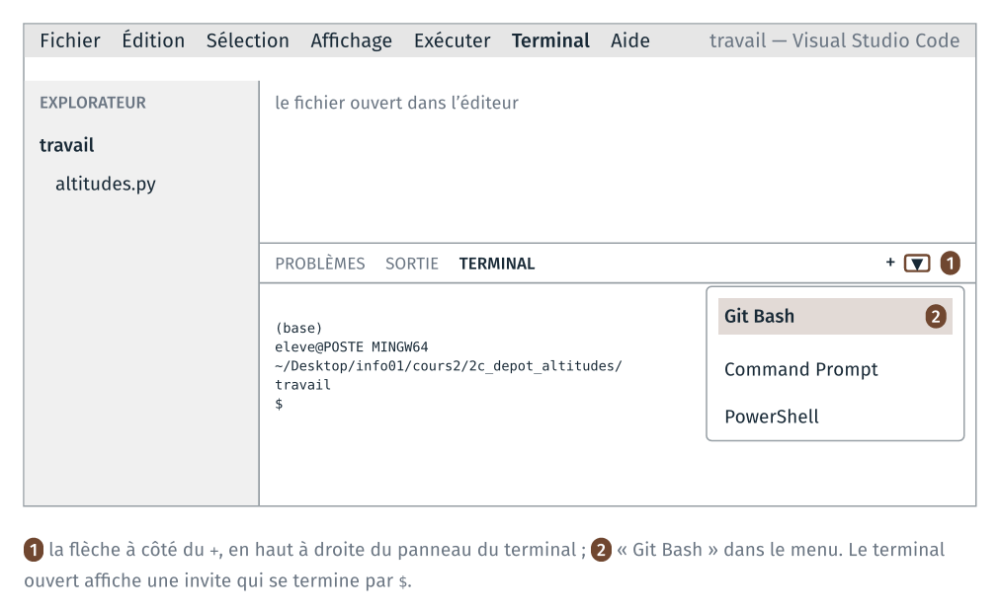
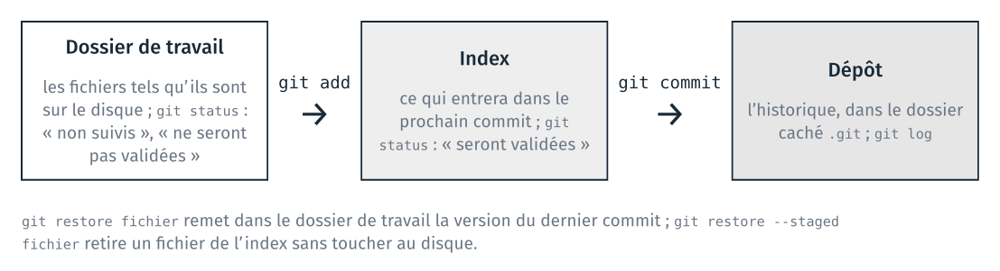
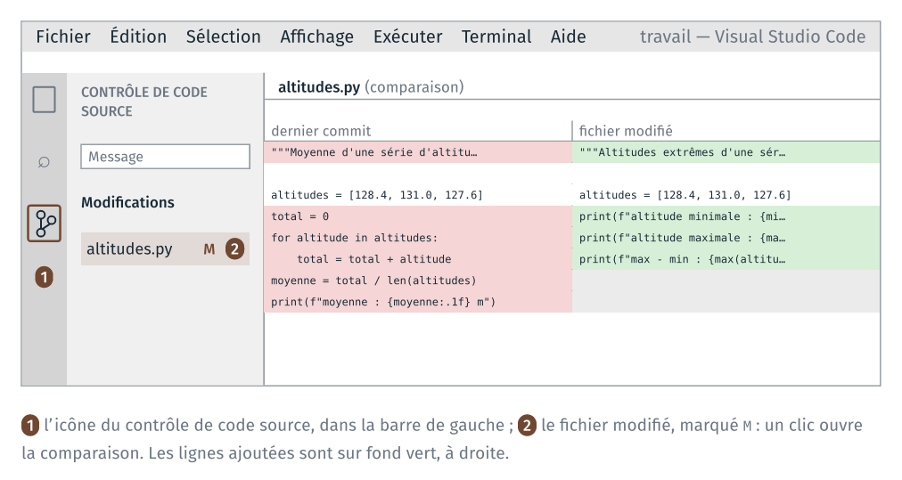
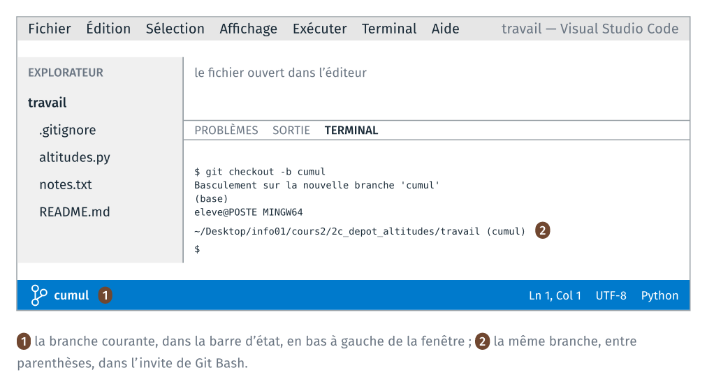
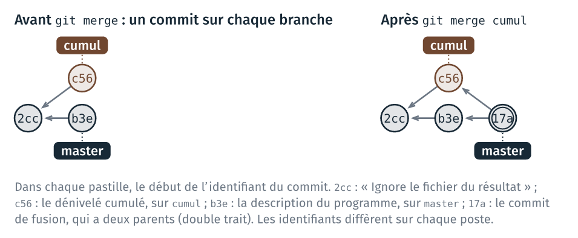
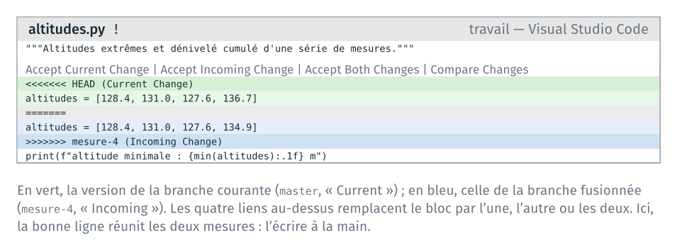

*Version 2 du cours 2 : proposition de travail pour 2027-2028. Les TD joués
en 2026 sont ceux de la séance 2, dans la partie « Archive 2026 ».*

Ce guide détaille les étapes du TD 2c. Le TD versionne avec git `altitudes.py`,
le programme du cours 1 : un premier commit, des modifications comparées, un
README, un fichier produit tenu hors du dépôt, puis une branche, une fusion et
un conflit. Le programme y gagne le calcul des altitudes extrêmes, de leur écart
et du dénivelé cumulé. Le code de ces calculs est fourni, car le TD porte sur
git. Le TD dure une quarantaine de minutes. L'étape 7 est pour ceux qui ont fini.

Le code de ce guide se copie depuis `guide_2c_depot_altitudes.html`, ouvert dans
un navigateur, ou depuis `guide.ipynb`, ouvert dans JupyterLab. Copié depuis le
PDF, il perd ses indentations.

Pour chaque étape, le guide donne :

- les commandes à taper, dans l'ordre ;
- ce que git affiche en retour, relevé sur un poste où git parle français ;
- comment vérifier que la commande a fonctionné, et quoi faire sinon.

Les sorties de ce guide ont été relevées avec git 2.43 en français. Sur un
poste où git parle anglais, les messages sont les mêmes, en anglais : le
guide donne entre parenthèses les phrases anglaises à reconnaître. Les
identifiants de commit (`4726396`…) sont différents sur chaque poste.

| Étape | Objectif | Ce qu'on fait | Commits à la fin |
|---|---|---|---|
| 0 | séparer le travail des fichiers livrés | copier le programme dans `travail/`, l'ouvrir dans VS Code | 0 |
| 1 | créer un dépôt et enregistrer un premier état | créer le dépôt, faire le premier commit | 1 |
| 2 | lire une différence, puis l'enregistrer | modifier le programme, lire la différence, faire un commit | 2 |
| 3 | annuler une modification non enregistrée | abîmer une ligne, puis la restaurer | 2 |
| 4 | décrire le projet, et ne pas versionner les fichiers produits | écrire un README, ignorer le fichier du résultat | 4 |
| 5 | développer un calcul sur une branche, puis fusionner | le dénivelé cumulé sur une branche, fusionné | 7 |
| 6 | résoudre un conflit de fusion | la même ligne modifiée sur deux branches, et le conflit résolu | 10 |
| 7 | copier un dépôt, et récupérer un commit fait dans la copie | pour aller plus loin : une seconde copie du dépôt | 11 |

Si le temps manque en séance, s'arrêter après l'étape 5 ; l'étape 6 se
fait ensuite avec ce guide.

## Rappels avant de commencer

**VS Code et son terminal.** Tout le TD se fait dans VS Code : l'explorateur
à gauche, le fichier ouvert au centre, le terminal Git Bash en bas. Le
terminal s'ouvre par le menu Terminal → New Terminal. Le TD 2a a fait de
Git Bash le terminal par défaut ; si le terminal ouvert est PowerShell,
choisir « Git Bash » dans la liste ouverte par la flèche à côté du `+`.



**L'invite de Git Bash.** Elle tient sur plusieurs lignes : `(base)`, puis
`eleve@POSTE MINGW64` suivi du dossier courant, puis `$`. Une fois le dépôt
créé, Git Bash ajoute à la fin du dossier courant le nom de la branche,
entre parenthèses : `~/…/travail (master)`.

**Enregistrer.** Le réglage `files.autoSave` du TD 2a enregistre les
fichiers tout seuls, après une seconde. Sans lui, `Ctrl` + `S` après chaque
modification : git lit le fichier enregistré sur le disque.

**La commande à taper en cas de doute.** `git status` affiche la
branche courante, les fichiers qui ont changé, et les commandes qui
s'appliquent. La taper avant de demander de l'aide.

**L'aide de git.** Chaque commande du TD est `git` suivi d'une
sous-commande : `init`, `add`, `commit`… `git add -h` affiche dans le
terminal les options de `add` ; `git add --help` ouvre la page complète du
manuel dans le navigateur.

**Les trois zones de git.** Le schéma ci-dessous sert à toutes les étapes.
`git add` place un fichier dans l'index ; `git commit` enregistre l'index
dans le dépôt.



**Un éditeur s'ouvre dans le terminal.** Si une commande git ouvre un
écran avec des `~` en début de ligne, l'éditeur vim est ouvert, pour
écrire un message. Taper `Échap`, puis `:wq` et `Entrée` pour garder le message
proposé, ou `:q!` et `Entrée` pour abandonner. Le guide donne chaque message
par `-m` pour éviter cet écran.

## Étape 0 · Préparer le dossier

> **À faire :** copier `altitudes.py` de `depart/` dans `2c_depot_altitudes/travail/` ; ouvrir `travail/` dans VS Code, avec un terminal Git Bash ; lancer le programme.
>
> **À obtenir :** l'explorateur de VS Code montre `altitudes.py` ; l'invite se termine par `2c_depot_altitudes/travail` ; le programme affiche `moyenne : 129.0 m`.

**Dossier de départ** : `cours2/2c_depot_altitudes/`, tel que décompressé
depuis l'archive.

```text
2c_depot_altitudes/
├── depart/
│   └── altitudes.py
└── travail/             (vide)
```

### 0.1 Copier le programme

Dans le terminal de VS Code, se placer dans le dossier du TD, puis copier
le programme :

```text
cd ~/Desktop/info01/cours2/2c_depot_altitudes
cp depart/altitudes.py travail/
```

**Vérification** : `ls travail` affiche `altitudes.py`.

### 0.2 Ouvrir `travail/` dans VS Code

File → Open Folder… → choisir `cours2\2c_depot_altitudes\travail`. VS Code se
rouvre sur ce dossier ; ouvrir un terminal (Terminal → New Terminal).

**Vérification** : l'explorateur montre le fichier ; dans le
terminal, `pwd` affiche un chemin qui se termine par
`2c_depot_altitudes/travail`.

Le dépôt se crée dans le dossier courant du terminal. Si `pwd` affiche un
autre dossier, `cd` jusqu'à `travail/` avant l'étape 1.

### 0.3 Lancer le programme

```text
python altitudes.py
```

```text
moyenne : 129.0 m
```

Ce programme est celui du cours 1, déjà lancé au TD 2a.

## Étape 1 · Le dépôt et le premier commit

> **À faire :** `git init` ; régler son nom et son adresse pour ce dépôt ; `git add`, puis `git commit`.
>
> **À obtenir :** `git log --oneline` affiche une ligne, `Ajoute le calcul de la moyenne`.

### 1.1 Créer le dépôt

```text
git init
```

git affiche d'abord une dizaine de lignes qui commencent par `astuce:`
(`hint:` en anglais), sur le nom de la branche initiale : les ignorer. La
dernière ligne est :

```text
Dépôt Git vide initialisé dans …/2c_depot_altitudes/travail/.git/
```

(« Initialized empty Git repository in … ».) Puis :

```text
ls -a
```

```text
.
..
altitudes.py
.git
```

`.git` est le dépôt : un dossier caché, qui contiendra l'historique. Les
fichiers du dossier n'ont pas changé.

**Vérification** : l'invite se termine maintenant par `(master)`.

Si `git init` a été tapé dans un autre dossier (`2c_depot_altitudes/` par
exemple), supprimer le `.git` créé par erreur (`rm -rf .git`, dans ce
dossier-là), puis revenir dans `travail/` et recommencer.

### 1.2 Signer ses commits

Chaque commit porte le nom et l'adresse de son auteur. Les postes de la
salle sont partagés : le réglage se fait dans le dépôt, sans `--global`, et
ne vaut que pour lui.

```text
git config user.name "Prénom Nom"
git config user.email "prenom.nom@ensg.eu"
```

Remplacer par vos nom et adresse. Aucun message ne s'affiche.

**Vérification** : `git config user.name` affiche le nom.

### 1.3 Ce que git voit

```text
git status
```

```text
Sur la branche master

Aucun commit

Fichiers non suivis:
  (utilisez "git add <fichier>..." pour inclure dans ce qui sera validé)
	altitudes.py

aucune modification ajoutée à la validation mais des fichiers non suivis sont présents (utilisez "git add" pour les suivre)
```

Le fichier est « non suivi » (« Untracked files ») : git le voit
dans le dossier, mais ne l'a jamais enregistré.

### 1.4 Le premier commit

```text
git add altitudes.py
git status
```

```text
Sur la branche master

Aucun commit

Modifications qui seront validées :
  (utilisez "git rm --cached <fichier>..." pour désindexer)
	nouveau fichier : altitudes.py
```

Le fichier est dans l'index (« Changes to be committed »). Le
commit enregistre l'index, avec un message qui décrit ce qu'il apporte :

```text
git commit -m "Ajoute le calcul de la moyenne"
```

```text
[master (commit racine) 4726396] Ajoute le calcul de la moyenne
 1 file changed, 8 insertions(+)
 create mode 100644 altitudes.py
```

`4726396` est le début de l'identifiant du commit ; le vôtre est différent.

**Vérification** :

```text
git log --oneline
```

```text
4726396 Ajoute le calcul de la moyenne
```

Si `git commit` affiche `Please tell me who you are`, l'étape 1.2 n'a pas
été faite dans ce dépôt : la faire, puis refaire le `git commit`.

## Étape 2 · Modifier, comparer, enregistrer

> **À faire :** remplacer la moyenne par les altitudes extrêmes dans `altitudes.py` ; lire `git status` et `git diff` ; faire un commit.
>
> **À obtenir :** le programme affiche `127.6`, `131.0` et `3.4` ; `git log --oneline` affiche deux lignes.

### 2.1 Modifier le programme

Dans `altitudes.py`, remplacer la première ligne par :

```python
"""Altitudes extrêmes d'une série de mesures."""
```

Remplacer ensuite les lignes de `total = 0` jusqu'au `print` par ces trois
lignes :

```python
print(f"altitude minimale : {min(altitudes):.1f} m")
print(f"altitude maximale : {max(altitudes):.1f} m")
print(f"max - min : {max(altitudes) - min(altitudes):.1f} m")
```

`min` et `max` sont des fonctions de Python, qui reçoivent la liste. Enregistrer,
puis lancer le programme :

```text
python altitudes.py
```

```text
altitude minimale : 127.6 m
altitude maximale : 131.0 m
max - min : 3.4 m
```

### 2.2 Ce que git voit

```text
git status
```

```text
Sur la branche master
Modifications qui ne seront pas validées :
  (utilisez "git add <fichier>..." pour mettre à jour ce qui sera validé)
  (utilisez "git restore <fichier>..." pour annuler les modifications dans le répertoire de travail)
	modifié :         altitudes.py

aucune modification n'a été ajoutée à la validation (utilisez "git add" ou "git commit -a")
```

`altitudes.py` est modifié dans le dossier de travail, et pas encore dans
l'index (« Changes not staged for commit »). Les deux commandes proposées
entre parenthèses sont celles des étapes 2.4 et 3.

### 2.3 Lire la différence

```text
git diff
```

```text
diff --git a/altitudes.py b/altitudes.py
index 613e856..1ad773e 100644
--- a/altitudes.py
+++ b/altitudes.py
@@ -1,8 +1,6 @@
-"""Moyenne d'une série d'altitudes, à la main plutôt qu'avec sum()."""
+"""Altitudes extrêmes d'une série de mesures."""
 
 altitudes = [128.4, 131.0, 127.6]
-total = 0
-for altitude in altitudes:
-    total = total + altitude
-moyenne = total / len(altitudes)
-print(f"moyenne : {moyenne:.1f} m")
+print(f"altitude minimale : {min(altitudes):.1f} m")
+print(f"altitude maximale : {max(altitudes):.1f} m")
+print(f"max - min : {max(altitudes) - min(altitudes):.1f} m")
```

`a/` est la version du dernier commit, `b/` celle du disque. Les lignes qui
commencent par `-` sont les anciennes, celles qui commencent par `+` les nouvelles ;
les autres lignes sont le contexte. `@@ -1,8 +1,6 @@` indique que le passage
commence à la ligne 1, et fait 8 lignes avant et 6 lignes après.

La même différence se lit dans VS Code : icône du contrôle de code source,
dans la barre de gauche (`Ctrl` + `Maj` + `G`), puis clic sur `altitudes.py`.



### 2.4 Le commit

```text
git add altitudes.py
git commit -m "Remplace la moyenne par les altitudes extrêmes"
```

```text
[master d2f927b] Remplace la moyenne par les altitudes extrêmes
 1 file changed, 4 insertions(+), 6 deletions(-)
```

Une ligne modifiée compte pour une ligne retirée et une ligne ajoutée. Le calcul
de la moyenne n'a plus sa place dans le fichier, mais il reste dans le premier
commit.

**Vérification** :

```text
git log --oneline
```

```text
d2f927b Remplace la moyenne par les altitudes extrêmes
4726396 Ajoute le calcul de la moyenne
```

Le commit le plus récent est en haut. `git log`, sans option, donne aussi
l'identifiant complet, l'auteur et la date de chaque commit ; `q` quitte
l'affichage s'il ne tient pas dans le terminal.

## Étape 3 · Annuler une modification non enregistrée

> **À faire :** abîmer une ligne du programme ; lancer le programme ; voir la ligne dans `git diff` ; `git restore`.
>
> **À obtenir :** `git status` affiche « rien à valider » ; le programme fonctionne de nouveau.

### 3.1 Abîmer une ligne

Dans `altitudes.py`, à la ligne `altitude maximale`, remplacer `max(altitudes)` par
`max(altitude)`, et enregistrer. Puis :

```text
python altitudes.py
```

```text
altitude minimale : 127.6 m
Traceback (most recent call last):
  File "…/2c_depot_altitudes/travail/altitudes.py", line 5, in <module>
    print(f"altitude maximale : {max(altitude):.1f} m")
                                     ^^^^^^^^
NameError: name 'altitude' is not defined. Did you mean: 'altitudes'?
```

Le programme s'arrête à cette ligne, comme les programmes fautifs du TD 2b.

```text
git diff
```

```text
diff --git a/altitudes.py b/altitudes.py
index 1ad773e..4f93241 100644
--- a/altitudes.py
+++ b/altitudes.py
@@ -2,5 +2,5 @@
 
 altitudes = [128.4, 131.0, 127.6]
 print(f"altitude minimale : {min(altitudes):.1f} m")
-print(f"altitude maximale : {max(altitudes):.1f} m")
+print(f"altitude maximale : {max(altitude):.1f} m")
 print(f"max - min : {max(altitudes) - min(altitudes):.1f} m")
```

### 3.2 Restaurer le fichier

```text
git restore altitudes.py
git status
```

```text
Sur la branche master
rien à valider, la copie de travail est propre
```

(« nothing to commit, working tree clean ».)

**Vérification** : `python altitudes.py` affiche de nouveau ses trois lignes.

`git restore` remet le fichier dans l'état du dernier commit : la
modification est perdue, et aucune commande ne la retrouve. git ne peut
restaurer que ce qui a été enregistré par un commit.

## Étape 4 · Un README, et un fichier produit

> **À faire :** écrire `README.md` et en faire un commit ; écrire le résultat du programme dans `resultat.txt` ; lire `git status` ; écrire un fichier `.gitignore` et en faire un commit.
>
> **À obtenir :** `git status` affiche « rien à valider », alors que `resultat.txt` est dans le dossier.

### 4.1 Écrire le README

`README.md`, à la racine d'un projet, décrit ce qu'il fait et comment s'en
servir. Dans VS Code : explorateur, clic droit sur un endroit vide, « New
File… », nom `README.md`. Y écrire ces lignes, puis enregistrer :

```text
# Altitudes

Ce programme affiche des statistiques sur une série d'altitudes, en mètres.

## Utilisation

Écrire les altitudes dans la liste `altitudes`, puis lancer `python altitudes.py`.
```

La syntaxe est celle des cellules de texte du cours 1. `Ctrl` + `Maj` + `V`
ouvre l'aperçu du fichier dans VS Code.

```text
git add README.md
git commit -m "Ajoute un README"
```

```text
[master 9cd57cf] Ajoute un README
 1 file changed, 7 insertions(+)
 create mode 100644 README.md
```

### 4.2 Produire un fichier

Le signe `>` écrit la sortie d'une commande dans un fichier, à la place du
terminal. Rien ne s'affiche :

```text
python altitudes.py > resultat.txt
cat resultat.txt
```

```text
altitude minimale : 127.6 m
altitude maximale : 131.0 m
max - min : 3.4 m
```

```text
git status
```

```text
Sur la branche master
Fichiers non suivis:
  (utilisez "git add <fichier>..." pour inclure dans ce qui sera validé)
	resultat.txt

aucune modification ajoutée à la validation mais des fichiers non suivis sont présents (utilisez "git add" pour les suivre)
```

`resultat.txt` se refait par la même commande. Le versionner ajouterait à
l'historique une copie de chacune de ses versions, alors que `altitudes.py`
permet de le refaire.

### 4.3 Le fichier `.gitignore`

`.gitignore` est un fichier texte, à la racine du dépôt. Chaque ligne est
un motif de noms de fichiers que `git status` n'affiche plus et que
`git add` n'ajoute pas. Son
nom commence par un point, sans autre extension.

Dans VS Code : explorateur, clic droit sur un endroit vide, « New File… »,
nom `.gitignore`. Y écrire une ligne, puis enregistrer :

```text
resultat.txt
```

Un motif peut contenir `*`, qui remplace n'importe quelle suite de caractères,
comme dans Git Bash au cours 1.

```text
git status
```

```text
Sur la branche master
Fichiers non suivis:
  (utilisez "git add <fichier>..." pour inclure dans ce qui sera validé)
	.gitignore

aucune modification ajoutée à la validation mais des fichiers non suivis sont présents (utilisez "git add" pour les suivre)
```

`resultat.txt` n'apparaît plus. `.gitignore` est un
fichier du projet comme un autre : il se versionne.

### 4.4 Le commit

```text
git add .gitignore
git commit -m "Ignore le fichier du résultat"
```

```text
[master 02b563f] Ignore le fichier du résultat
 1 file changed, 1 insertion(+)
 create mode 100644 .gitignore
```

**Vérification** :

```text
git status
ls
```

```text
Sur la branche master
rien à valider, la copie de travail est propre
```

```text
altitudes.py
README.md
resultat.txt
```

Le fichier produit est dans le dossier ; `git status` ne l'affiche
pas.

## Étape 5 · Une branche, puis la fusion

> **À faire :** créer la branche `cumul` et y ajouter le dénivelé cumulé ; revenir sur `master` et y compléter la description du programme ; fusionner `cumul` dans `master`.
>
> **À obtenir :** le programme affiche le dénivelé cumulé, et sa première ligne est complétée ; `git log --oneline --graph` montre la fusion.

### 5.1 Créer la branche

```text
git branch
```

```text
* master
```

Une seule branche, `master`, marquée d'une étoile : la branche courante.

```text
git checkout -b cumul
```

```text
Basculement sur la nouvelle branche 'cumul'
```

(« Switched to a new branch 'cumul' ».)

**Vérification** : l'invite se termine par `(cumul)`, et la barre
d'état de VS Code, en bas à gauche, affiche `cumul`.



### 5.2 Le dénivelé cumulé

Le dénivelé cumulé est la somme des écarts d'altitude d'un point au suivant,
avec un total pour les hausses et un total pour les baisses. À la fin
d'`altitudes.py`, ajouter une ligne vide, puis ces lignes :

```python
hausse = 0
baisse = 0
for i in range(1, len(altitudes)):
    ecart = altitudes[i] - altitudes[i - 1]
    if ecart > 0:
        hausse = hausse + ecart
    else:
        baisse = baisse - ecart
print(f"cumul en hausse : {hausse:.1f} m")
print(f"cumul en baisse : {baisse:.1f} m")
```

Enregistrer, puis lancer le programme :

```text
python altitudes.py
```

```text
altitude minimale : 127.6 m
altitude maximale : 131.0 m
max - min : 3.4 m
cumul en hausse : 2.6 m
cumul en baisse : 3.4 m
```

Sur les trois altitudes, 128.4, 131.0 et 127.6 : une hausse de 2.6 m, puis une
baisse de 3.4 m.

```text
git add altitudes.py
git commit -m "Ajoute le dénivelé cumulé"
```

```text
[cumul 18b88ab] Ajoute le dénivelé cumulé
 1 file changed, 11 insertions(+)
```

### 5.3 Revenir sur `master`

```text
git checkout master
```

```text
Basculement sur la branche 'master'
```

Changer de branche remplace les fichiers du dossier par ceux du dernier
commit de la branche. Le dénivelé cumulé reste enregistré sur `cumul`.

**Vérification** : dans VS Code, `altitudes.py` se termine de nouveau par la ligne
`max - min`. Puis :

```text
python altitudes.py
```

```text
altitude minimale : 127.6 m
altitude maximale : 131.0 m
max - min : 3.4 m
```

### 5.4 Un commit sur `master`

Dans `altitudes.py`, remplacer la première ligne par la ligne suivante, puis
enregistrer :

```python
"""Altitudes extrêmes et dénivelé cumulé d'une série de mesures."""
```

```text
git add altitudes.py
git commit -m "Complète la description du programme"
git log --oneline --graph --all --decorate
```

```text
* 8624753 (HEAD -> master) Complète la description du programme
| * 18b88ab (cumul) Ajoute le dénivelé cumulé
|/  
* 02b563f Ignore le fichier du résultat
* 9cd57cf Ajoute un README
* d2f927b Remplace la moyenne par les altitudes extrêmes
* 4726396 Ajoute le calcul de la moyenne
```

Chaque `*` est un commit ; les traits dessinent les deux branches, parties
du même commit `02b563f`. `HEAD -> master` : la branche courante est
`master`.

### 5.5 Fusionner

La fusion se lance depuis la branche qui reçoit, ici `master` :

```text
git merge cumul -m "Fusionne le dénivelé cumulé"
```

```text
Fusion automatique de altitudes.py
Merge made by the 'ort' strategy.
 altitudes.py | 11 +++++++++++
 1 file changed, 11 insertions(+)
```

Les deux branches ont modifié `altitudes.py`, sur des lignes différentes :
git a réuni les deux modifications, et créé un commit de fusion.

**Vérification** : `python altitudes.py` affiche de nouveau le cumul, et la première
ligne d'`altitudes.py` est la description complétée. Puis :

```text
git log --oneline --graph
```

```text
*   6dbc9b3 Fusionne le dénivelé cumulé
|\  
| * 18b88ab Ajoute le dénivelé cumulé
* | 8624753 Complète la description du programme
|/  
* 02b563f Ignore le fichier du résultat
* 9cd57cf Ajoute un README
* d2f927b Remplace la moyenne par les altitudes extrêmes
* 4726396 Ajoute le calcul de la moyenne
```



Sans `-m`, `git merge` ouvre l'éditeur vim pour le message du commit de
fusion : `Échap`, puis `:wq` et `Entrée` gardent le message proposé.

## Étape 6 · Un conflit

> **À faire :** sur une branche `mesure-4`, ajouter la mesure `134.9` à la liste ; sur `master`, ajouter la mesure `136.7` à la même ligne ; fusionner, puis résoudre le conflit.
>
> **À obtenir :** la ligne `altitudes = [128.4, 131.0, 127.6, 134.9, 136.7]`, sans marqueur ; `git log --oneline --graph` montre deux fusions.

### 6.1 Deux modifications de la même ligne

La troisième ligne d'`altitudes.py` est :

```python
altitudes = [128.4, 131.0, 127.6]
```

Sur une nouvelle branche, ajouter `134.9` à la fin de la liste :

```text
git checkout -b mesure-4
```

Modifier la ligne, enregistrer, puis :

```text
git add altitudes.py
git commit -m "Ajoute la mesure 134.9"
```

```text
[mesure-4 6f72c61] Ajoute la mesure 134.9
 1 file changed, 1 insertion(+), 1 deletion(-)
```

Sur `master`, ajouter `136.7` à la fin de la liste, sur la même ligne :

```text
git checkout master
```

Modifier la ligne, enregistrer, puis :

```text
git add altitudes.py
git commit -m "Ajoute la mesure 136.7"
```

```text
[master 7e04ba9] Ajoute la mesure 136.7
 1 file changed, 1 insertion(+), 1 deletion(-)
```

### 6.2 La fusion s'arrête

```text
git merge mesure-4
```

```text
Fusion automatique de altitudes.py
CONFLIT (contenu) : Conflit de fusion dans altitudes.py
La fusion automatique a échoué ; réglez les conflits et validez le résultat.
```

(« CONFLICT (content): Merge conflict in altitudes.py ».) Les deux branches
ont modifié la même ligne : git arrête la fusion et
écrit les deux versions dans le fichier.

```text
git status
```

```text
Sur la branche master
Vous avez des chemins non fusionnés.
  (réglez les conflits puis lancez "git commit")
  (utilisez "git merge --abort" pour annuler la fusion)

Chemins non fusionnés :
  (utilisez "git add <fichier>..." pour marquer comme résolu)
	modifié des deux côtés :  altitudes.py

aucune modification n'a été ajoutée à la validation (utilisez "git add" ou "git commit -a")
```

L'invite affiche `(master|MERGING)` : une fusion est en cours.

### 6.3 Ce que contient le fichier

Le début d'`altitudes.py` est maintenant :

```text
"""Altitudes extrêmes et dénivelé cumulé d'une série de mesures."""

<<<<<<< HEAD
altitudes = [128.4, 131.0, 127.6, 136.7]
=======
altitudes = [128.4, 131.0, 127.6, 134.9]
>>>>>>> mesure-4
```

Entre `<<<<<<< HEAD` et `=======`, la ligne de la branche courante,
`master` ; entre `=======` et `>>>>>>> mesure-4`, celle de la branche
fusionnée. VS Code colore les deux versions et affiche quatre actions
au-dessus du bloc.



Les marqueurs ne sont pas du Python, et le programme ne se lance plus :

```text
python altitudes.py
```

```text
  File "…/2c_depot_altitudes/travail/altitudes.py", line 3
    <<<<<<< HEAD
    ^^
SyntaxError: invalid syntax
```

### 6.4 Résoudre

La bonne ligne garde les deux mesures : aucune des deux versions ne convient
telle quelle. Remplacer les cinq lignes du bloc (marqueurs compris) par la seule
ligne :

```python
altitudes = [128.4, 131.0, 127.6, 134.9, 136.7]
```

Enregistrer. Vérifier qu'il ne reste aucun marqueur : `Ctrl` + `F` dans
VS Code, chercher `<<<<`, puis `>>>>` et `====` ; la recherche affiche
« No results ». Puis :

```text
python altitudes.py
```

```text
altitude minimale : 127.6 m
altitude maximale : 136.7 m
max - min : 9.1 m
cumul en hausse : 11.7 m
cumul en baisse : 3.4 m
```

### 6.5 Terminer la fusion

```text
git add altitudes.py
git status
```

```text
Sur la branche master
Tous les conflits sont réglés mais la fusion n'est pas terminée.
  (utilisez "git commit" pour terminer la fusion)

Modifications qui seront validées :
	modifié :         altitudes.py
```

```text
git commit -m "Fusionne les deux mesures"
```

```text
[master 91c4702] Fusionne les deux mesures
```

### 6.6 Le graphe du dépôt

Avant de taper la commande suivante, dessiner sur papier le graphe du
dépôt : une pastille par commit, une flèche de chaque commit vers son ou
ses parents, et le nom de chaque branche à côté du commit qu'elle désigne,
comme sur les diapositives du cours. Puis comparer avec le dessin de git :

```text
git log --oneline --graph --all --decorate
```

```text
*   91c4702 (HEAD -> master) Fusionne les deux mesures
|\  
| * 6f72c61 (mesure-4) Ajoute la mesure 134.9
* | 7e04ba9 Ajoute la mesure 136.7
|/  
*   6dbc9b3 Fusionne le dénivelé cumulé
|\  
| * 18b88ab (cumul) Ajoute le dénivelé cumulé
* | 8624753 Complète la description du programme
|/  
* 02b563f Ignore le fichier du résultat
* 9cd57cf Ajoute un README
* d2f927b Remplace la moyenne par les altitudes extrêmes
* 4726396 Ajoute le calcul de la moyenne
```

git dessine le graphe de haut en bas, le commit le plus récent en haut.
Dix commits, dont deux fusions. `git branch` liste les trois branches :

```text
  cumul
* master
  mesure-4
```

Pour abandonner une fusion en conflit au lieu de la résoudre :
`git merge --abort` rend l'état d'avant le `git merge`.

## Étape 7 · Pour aller plus loin : une seconde copie du dépôt

> **À faire :** copier le dépôt par `git clone` ; faire un commit dans la copie ; le récupérer dans `travail/` par `git pull`.
>
> **À obtenir :** `git log --oneline -3` affiche le même dernier commit dans `copie/` et dans `travail/`.

Le dossier `.git` contient tout l'historique du projet. `git clone` crée
une copie complète du dépôt, dans un autre dossier ou sur un autre
support, comme une clé USB. Les deux dépôts échangent ensuite leurs commits. La forge du
cours 6 est un dépôt de plus, sur un serveur.

### 7.1 Copier le dépôt

```text
cd ..
git clone travail copie
```

```text
Clonage dans 'copie'...
fait.
```

(« Cloning into 'copie'... done. ») `cd ..` remonte dans
`2c_depot_altitudes/` ; `git clone` y crée `copie/`, à côté de `travail/`.
Pour copier le dépôt sur une clé USB, donner en second argument un dossier
de la clé, par exemple `/e/altitudes` pour le lecteur `E:`.

```text
cd copie
ls -a
git log --oneline -3
```

```text
.
..
altitudes.py
.git
.gitignore
README.md
```

```text
91c4702 Fusionne les deux mesures
7e04ba9 Ajoute la mesure 136.7
6f72c61 Ajoute la mesure 134.9
```

La copie a son propre dossier `.git`, avec les mêmes commits et les mêmes
identifiants. `resultat.txt`, ignoré, n'a pas été copié.

### 7.2 Le dépôt d'origine

```text
git remote -v
```

```text
origin	…/2c_depot_altitudes/travail (fetch)
origin	…/2c_depot_altitudes/travail (push)
```

La copie garde le chemin du dépôt dont elle vient, sous le nom `origin`.
Au cours 6, `origin` désigne le dépôt de la forge.

### 7.3 Un commit dans la copie

Le réglage de l'étape 1.2 est écrit dans `travail/.git`, et `git clone` ne
le copie pas : dans la copie, `git config user.name` n'affiche rien. Le
refaire :

```text
git config user.name "Prénom Nom"
git config user.email "prenom.nom@ensg.eu"
```

Ouvrir `copie/altitudes.py` dans VS Code (File → Open File…), ajouter `137.4` à la
fin de la liste, puis enregistrer :

```python
altitudes = [128.4, 131.0, 127.6, 134.9, 136.7, 137.4]
```

```text
git add altitudes.py
git commit -m "Ajoute la mesure 137.4"
```

```text
[master fc37f53] Ajoute la mesure 137.4
 1 file changed, 1 insertion(+), 1 deletion(-)
```

Ce commit n'existe que dans `copie/`.

### 7.4 Récupérer le commit dans `travail/`

```text
cd ../travail
git pull ../copie master
```

```text
Depuis ../copie
 * branch            master     -> FETCH_HEAD
Mise à jour 91c4702..fc37f53
Fast-forward
 altitudes.py | 2 +-
 1 file changed, 1 insertion(+), 1 deletion(-)
```

`git pull ../copie master` récupère les commits de la branche `master` du
dépôt `../copie` et les fusionne dans la branche courante. `travail/`
n'avait pas de commit nouveau : git avance `master` jusqu'au commit de la
copie (« Fast-forward »), sans commit de fusion.

**Vérification** :

```text
git log --oneline -3
```

```text
fc37f53 Ajoute la mesure 137.4
91c4702 Fusionne les deux mesures
7e04ba9 Ajoute la mesure 136.7
```

Le même identifiant, `fc37f53`, dans les deux dépôts. Dans VS Code,
la liste de `travail/altitudes.py` se termine par la mesure ajoutée dans la copie.

## Ce que le TD fait constater

À lire après avoir fait les étapes.

**Un commit enregistre l'index.** `git add` choisit ce qui entre dans le
prochain commit ; `git commit` l'enregistre. Entre les deux, `git status`
affiche la zone de chaque fichier (étapes 1, 2 et 4).

**Ce qui se refait ne se versionne pas.** `resultat.txt` se refait depuis
`altitudes.py` par la même commande. `.gitignore` le tient hors du dépôt
(étape 4.3).

**git ne restaure que ce qu'il a enregistré.** `git restore` remet la
version du dernier commit ; une modification jamais enregistrée par un
commit ne se retrouve pas (étape 3).

**Une branche porte une variante.** Changer de branche change les fichiers
du dossier, et donc ce que le programme affiche (étape 5.3). La fusion réunit des
modifications de lignes différentes sans rien demander (étape 5.5) ; sur la même
ligne, elle s'arrête, et la personne qui fusionne décide (étape 6).

**Chaque copie d'un dépôt contient tout l'historique.** `git clone` copie
tous les commits, et `git pull` fait passer les nouveaux commits d'un dépôt
à l'autre. Le réglage de l'auteur est propre à chaque dépôt (étape 7).

## Annexe · Les commandes du TD

| Commande | Ce qu'elle fait |
|---|---|
| `git init` | crée un dépôt dans le dossier courant |
| `git config user.name "…"` | règle le nom de l'auteur, pour ce dépôt |
| `git status` | l'état du dépôt : branche, fichiers modifiés, zone de chacun |
| `git add fichier` | place le fichier dans l'index |
| `git commit -m "message"` | enregistre l'index comme une nouvelle version |
| `git log --oneline --graph` | l'historique, une ligne par commit, avec les branches |
| `git diff` | les lignes modifiées depuis le dernier commit |
| `git restore fichier` | remet le fichier dans l'état du dernier commit |
| `git branch` | liste les branches |
| `git checkout -b nom` | crée une branche et s'y place |
| `git checkout nom` | change de branche |
| `git merge nom` | fusionne la branche `nom` dans la branche courante |
| `git merge --abort` | abandonne une fusion en conflit |
| `git clone source copie` | copie le dépôt `source` dans le dossier `copie` |
| `git remote -v` | affiche le dépôt d'origine d'une copie |
| `git pull dépôt branche` | récupère les commits d'une branche d'un autre dépôt, et les fusionne |
| `commande > fichier` | écrit la sortie de la commande dans le fichier |

Les sorties de ce guide ont été relevées en rejouant le TD par le script
`rejeu/rejeu.sh`, à côté de ce guide dans le dépôt du cours.
