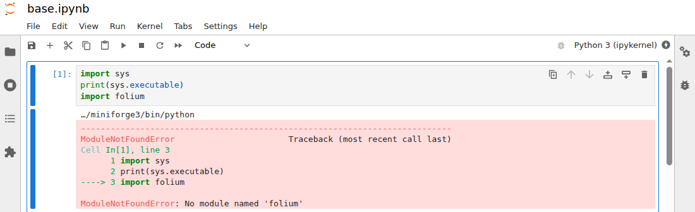
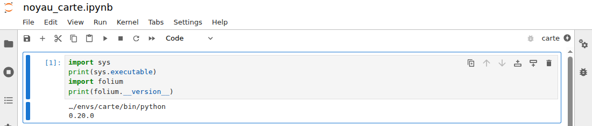

*Version 2 du cours 5 : proposition de travail pour 2027-2028. Ce TD est facultatif. Les captures et
les sorties de la cellule sont relevées sous Linux. Les chemins de Windows et les libellés du menu de
JupyterLab restent à relever sur un poste de la salle.*

Ce guide a trois parties. La présentation décrit le but du TD et ses étapes. L'énoncé donne, pour
chaque étape, l'objectif, les consignes et le test à faire. Les solutions expliquent chaque
commande, et donnent la marche à suivre si le résultat diffère.

# Présentation du TD

## Objectif du TD

Un notebook ouvert par le JupyterLab de `base` s'exécute avec le Python de `base`, et `import folium` y
échoue. Pour employer le Python de `carte`, il faut déclarer le noyau de cet environnement, puis le
choisir dans JupyterLab.

Le notebook `carte.ipynb` contient une cellule :

```python
import shutil
import sys
print(sys.executable)
print(shutil.which("ogr2ogr"))
import folium
print("folium", folium.__version__)
```

`sys.executable` donne le chemin de l'interpréteur qui exécute la cellule. `shutil.which` cherche un
programme dans `PATH`, comme la commande `which`, et renvoie `None` s'il ne le trouve pas.

## Les étapes

Le TD dure quinze minutes.

1. Constater l'erreur dans le notebook.
2. Déclarer le noyau de l'environnement.
3. Choisir le noyau dans JupyterLab.

### Les notions employées

| Notion | Diapositive |
|---|---|
| client, serveur et noyau | « Client et serveur : JupyterLab » |
| `ipykernel`, `kernel.json` | « Noyau d'un environnement : déclaration » |
| `sys.path` et `PATH` d'un noyau | « Noyau : recherche des dépendances » |

# Énoncé

## Étape 1 · Constater l'erreur dans le notebook

> **Objectif :** voir quel interpréteur exécute le notebook quand JupyterLab est lancé depuis `base`.

**Consignes**

1. Revenir à `base`, aller dans le dossier du TD, et copier ses fichiers dans `travail/` :

   ```text
   conda deactivate
   cd ../../5d_noyau
   cp depart/* travail/
   cd travail
   ```

2. Lancer JupyterLab :

   ```text
   jupyter lab
   ```

3. Ouvrir le notebook : double-cliquer sur `carte.ipynb`, dans le panneau de gauche.
4. Exécuter la cellule : `Maj` + `Entrée`.

**Test**

Le terminal reste occupé, et le navigateur ouvre une adresse `localhost`. Le nom du noyau,
`Python 3 (ipykernel)`, apparaît en haut à droite du notebook. La cellule affiche le chemin de
l'interpréteur de `base`, `C:\ProgramData\anaconda3\python.exe`, puis `None`, puis
`ModuleNotFoundError: No module named 'folium'`.

Sous Linux, avec un environnement d'essai à la place de `base`, une cellule plus courte donne cet
affichage :



Si `jupyter lab` affiche une erreur, voir la [solution de l'étape 1](#solution-de-létape-1).

## Étape 2 · Déclarer le noyau de l'environnement

> **Objectif :** faire connaître à JupyterLab l'interpréteur de `carte`.

**Consignes**

1. Revenir au second terminal, ouvert au TD 5a : cliquer sur son nom, dans la liste des terminaux.
2. Activer l'environnement, et y installer `ipykernel` :

   ```text
   conda activate carte
   conda install -y -c conda-forge ipykernel
   ```

3. Déclarer le noyau :

   ```text
   python -m ipykernel install --user --name carte
   ```

**Test**

La dernière commande affiche `Installed kernelspec carte in`, suivi d'un dossier qui se termine par
`jupyter\kernels\carte`.

Si cette commande affiche une erreur, voir la [solution de l'étape 2](#solution-de-létape-2).

## Étape 3 · Choisir le noyau dans JupyterLab

> **Objectif :** exécuter la cellule avec l'interpréteur de `carte`, puis arrêter le serveur.

**Consignes**

1. Recharger la page de JupyterLab : `F5`.
2. Choisir le noyau : cliquer sur `Python 3 (ipykernel)`, en haut à droite, choisir `carte`, puis
   Select.
3. Relancer le noyau et exécuter la cellule : menu Kernel, Restart Kernel and Run All Cells…, puis
   confirmer.
4. Arrêter le serveur : revenir au premier terminal, puis taper `Ctrl` + `C` deux fois.

**Test**

Le nom `carte` apparaît en haut à droite. La cellule affiche le chemin de l'interpréteur de `carte`,
`…\.conda\envs\carte\python.exe`, puis `None`, puis `folium 0.20.0`.

Sous Linux, une cellule plus courte donne cet affichage :



Après `Ctrl` + `C`, le terminal rend la main, et le navigateur signale que le serveur ne répond plus.

Si `carte` n'apparaît pas dans la liste, voir la [solution de l'étape 3](#solution-de-létape-3).

# Solutions

## Solution de l'étape 1

`jupyter lab` démarre le serveur, et le terminal reste occupé tant que le serveur tourne. Le navigateur
est le client. Le serveur lance le noyau `Python 3 (ipykernel)`, qui est ici l'interpréteur de `base`.
Cet interpréteur cherche ses bibliothèques dans ses propres dossiers, qui ne contiennent pas `folium`.

`None` indique qu'aucun dossier de `PATH` ne contient `ogr2ogr`.

Si le terminal affiche `bash: jupyter: command not found`, l'invite commence sans doute par `(carte)` :
`jupyterlab` n'est pas installé dans cet environnement, et l'activation a retiré `base` de `PATH`. Lancer
`conda deactivate`, puis relancer `jupyter lab`.

Si le navigateur ne s'ouvre pas, recopier dans sa barre d'adresse la ligne du terminal qui commence par
`http://localhost:8888/lab?token=`.

## Solution de l'étape 2

Le premier terminal reste occupé par le serveur : le second terminal reçoit donc ces commandes.

`ipykernel` permet à un interpréteur Python de servir de noyau. `python -m ipykernel install` écrit un
fichier `kernel.json`, qui donne le chemin de cet interpréteur. `--user` écrit ce fichier dans le compte,
et `--name carte` donne le nom du noyau. Le fichier se trouve dans
`AppData\Roaming\jupyter\kernels\carte\ `.

Depuis `base`, `jupyter kernelspec list` affiche les noyaux déclarés.

Si `python -m ipykernel install` affiche `No module named ipykernel`, l'installation n'a pas abouti, ou
l'invite ne commence pas par `(carte)`. Reprendre la consigne 2.

## Solution de l'étape 3

Le serveur déjà lancé trouve le nouveau `kernel.json` sans redémarrer. La page du navigateur peut garder
l'ancienne liste de noyaux, d'où le rechargement.

Le noyau `carte` exécute la cellule avec l'interpréteur de `carte`, et `import folium` réussit. `ogr2ogr`
reste à `None`, car le noyau reçoit le `PATH` du serveur, lancé depuis `base`. Un appel à `ogr2ogr` par
`subprocess.run` lèverait donc `FileNotFoundError` dans ce notebook.

Pour trouver aussi `ogr2ogr`, il faut installer `jupyterlab` dans `carte`, puis lancer `jupyter lab` après
`conda activate carte`. Essayé sous Linux, ce choix ajoute 64 paquets et 120 Mo à l'environnement.

`Ctrl` + `C` deux fois arrête le serveur. Fermer l'onglet du navigateur ne l'arrête pas.

Si `carte` n'apparaît pas dans la liste, recharger de nouveau la page, puis voir le cas J1 de la page
[Problèmes avec JupyterLab et les notebooks](../../../../annexes/problemes/jupyterlab.md). Si la
cellule n'exécute pas le Python attendu, voir le cas J4 de la même page.
